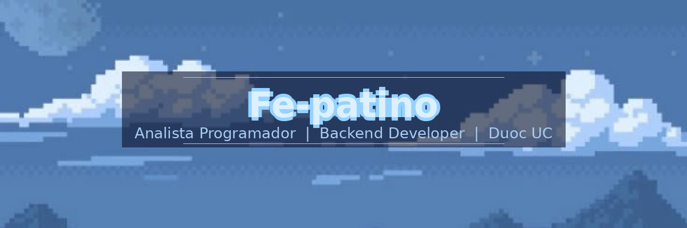

  

---

## 🧑‍💻 Sobre mí

> *"El código es poesía hecha lógica."*

- 🎓 Estudio **Analista Programador** en **Duoc UC** · 2° año
- 💻 Me apasiona el desarrollo **Backend** y la arquitectura de software
- ☁️ Actualmente aprendiendo **AWS** y profundizando en **Spring Boot**
- 🗄️ Experiencia con bases de datos **MySQL** y **Oracle**
- 🚀 Buscando proyectos reales donde aplicar mis conocimientos
- 📍 Santiago, Chile
- ⚡ Me gusta entender cómo funcionan las cosas por dentro

---

## 🛠️ Lenguajes y herramientas

### 💻 Lenguajes

  

### ⚙️ Frameworks

  

### 🗄️ Bases de Datos

  

### ☁️ Cloud & DevOps

  

### 🔧 Herramientas

  

---

## ⚡ Tech Stack completo

  
  
  
  
  
  
  
  
  
  
  

---

## 📊 GitHub Stats

  
  

  

  

---

## 🏆 Trofeos GitHub

  

---

## 💡 Random Dev Quote

  

---

## 📬 Encuéntrame en

---

